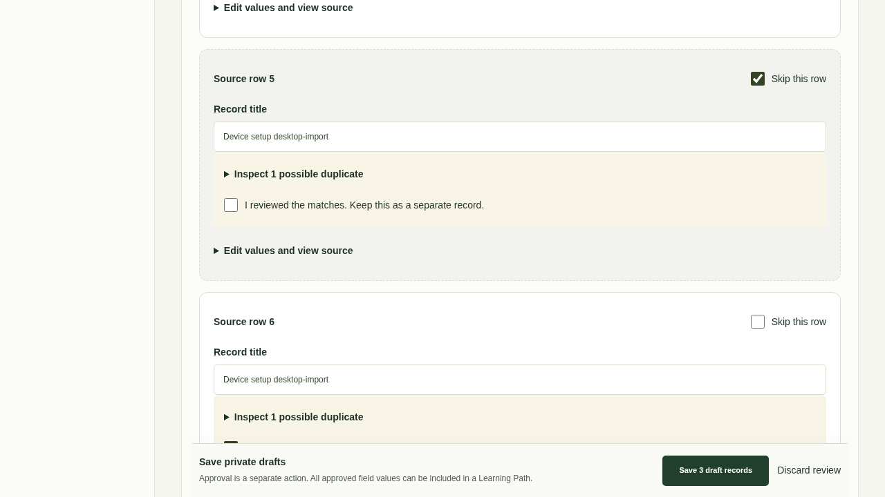
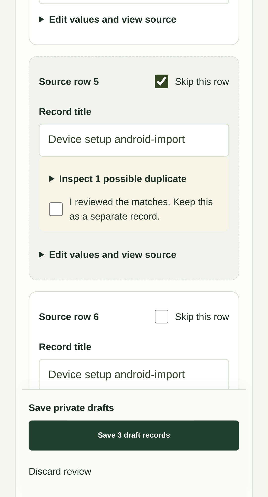
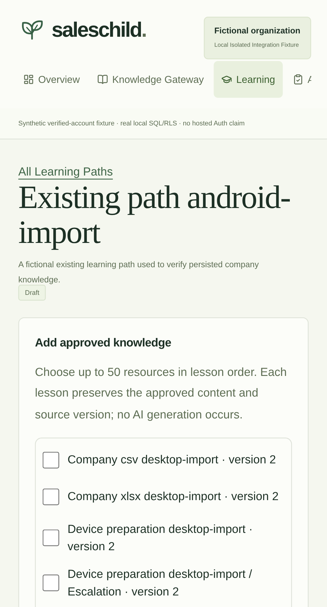

# Universal Knowledge Gateway — Phase 1

Tracks [Issue #3](https://github.com/shettysam28-cell/Saleschild/issues/3).

## What works

The authenticated Knowledge Gateway offers **Upload → Review → Save** for company-defined CSV/XLSX columns and structured Word DOCX documents. Existing source templates and the existing Academy preview remain optional presets.

- Keep arbitrary columns, duplicate labels and empty cells. Select a worksheet, override title/intro rows, choose no header row, rename columns or edit record titles and values. No fixed Saleschild column set is required.
- Review totals, row-specific issues and exact duplicates. Bulk-skip exact repeats, reinstate excluded rows and inspect title-based possible duplicates. Different facts sharing a topic remain separate records after reviewer confirmation; semantic AI matching is not claimed.
- Resume private review progress. Parsing is reused from an organization/uploader-scoped extraction, with revision checks for concurrent edits. Review sessions expire after 24 hours; expired unused sessions are removed on the uploader's next upload, not by a background deletion service. Saved source snapshots are retained.
- Save atomically as drafts, retry interrupted responses safely, and preserve original source values, filename/hash, worksheet/header/row coordinates and document blocks. In-app edits create new draft versions. An owner or administrator separately approves publication.
- Add approved knowledge to an existing draft Learning Path in a selected order. Reopen the path by its direct URL to read persisted lessons and custom fields. Lessons reference approved knowledge versions; later source edits do not replace those snapshots. Duplicate source versions cannot be appended accidentally, and database guards reject forged/unapproved linked lessons.
- Authenticated logo navigation resolves through server workspace authorization. Anonymous logo navigation returns to marketing. Safe protected return paths are preserved during login.

Public-information verification is visibly unavailable and off. No company content is sent to an external verification or AI service. Resend remains disabled.

## Source guide and limits

Use UTF-8 CSV with comma, semicolon or tab separators; quoting, multiline values, BOM and common line endings are supported. XLSX supports shared/inline strings, Unicode, dates, formatted values and worksheet selection. Paste spreadsheet formula results as values; formulas and unsafe workbook features are rejected.

For DOCX, use Heading 1/2/3 etc. followed by selectable paragraphs, lists and tables. Confirm inferred sections during review. Text order is retained; visual page formatting and original list numbering are not reproduced. Images/scans, page headers/footers and footnotes are not extracted. Accept or reject tracked changes and flatten document fields before uploading. OCR, PowerPoint, PDF and legacy DOC/XLS processing are outside this release.

| Limit                                            | Bound                                                        |
| ------------------------------------------------ | ------------------------------------------------------------ |
| Source upload                                    | 2 MiB                                                        |
| Records saved per batch                          | 1–200                                                        |
| Spreadsheet preview                              | Up to 250 populated rows plus a header                       |
| Columns / worksheets                             | 32 populated columns / 20 worksheets                         |
| Spreadsheet structure                            | 10,000 cells and physical row 10,000 per worksheet           |
| Cell / combined knowledge content                | 12,000 / 20,000 characters                                   |
| Extracted JSON / edited choices / reviewed batch | 2.5 MB / 2.5 MB / 3.5 MB                                     |
| Office ZIP expansion                             | 4 MiB per entry, 8 MiB total, 128 entries                    |
| Active reviews / daily uploads                   | 5 unused reviews / 50 uploads per user and organization      |
| Learning Path source picker / addition / path    | First 200 approved resources / 50 per addition / 500 lessons |

Actual Office formulas, macros, ActiveX, embedded objects, document types/entities and unsafe external relationships are rejected. Ordinary hyperlinks become text and are never fetched. Uploaded text remains untrusted data; it is never interpreted as code, HTML or AI instructions. Existing template downloads continue to escape spreadsheet formula-leading values.

## Migration and operations

The additive `universal_knowledge_gateway` migration adds three RLS-protected tables for private upload reviews, immutable source provenance and Learning Path source batches. Existing knowledge/current-version rows gain bounded custom fields; lessons gain tenant-safe references to approved knowledge versions. Legacy rows, source snapshots, original migration files and existing Academy behavior are preserved. All new public RPCs use SECURITY INVOKER with anonymous execution revoked. No privileged browser credential or new environment variable is required. The follow-up `learning_path_author_access` migration removes a source row-lock that incorrectly invoked published-record UPDATE policies for editors; organization serialization, SELECT RLS, immutable source guards and publication permissions remain enforced.

Apply this migration through the controlled database migration workflow before releasing the application. A website build does not apply migrations automatically. Existing Netlify configuration, Next.js runtime and the matching-main-CI production gate remain in place. No runtime dependency was added.

## Validation evidence

- 201 unit/integration/database tests, including real SQL/RLS, source/version preservation, cache reuse, stale revisions, idempotent retries, tenant/role denial and malicious Office structures.
- 38 public-site Playwright checks for accessibility, protected routes, responsive layouts, navigation and reduced motion.
- 12 dedicated desktop/Android-emulation browser journeys, including native templates, custom three-column XLSX, company multi-column XLSX/CSV, DOCX, corrections, duplicate management, interrupted-response recovery, approval, ordered Learning Path snapshots and reopening after source edits. The mobile harness includes a viewport tag and asserts its effective CSS viewport width.
- Formatting, lint, TypeScript, production build and source/repository/build-artifact scans. npm audit has 27 moderate transitive advisories; no high/critical advisories. No forced dependency downgrades were applied.

The controlled local 200-record benchmark reduced parser calls per journey from three to one. Across five measured runs after warmup, median extraction/review CPU work fell from **183.7 ms to 92.4 ms (50%)**. This is a shared-executor lab comparison, excluding network/database latency and hosted cold starts, not field performance.

Screenshots below contain fictional data in an isolated local fixture. Browser tests use production parsing/actions/components and actual migrations/RLS in PGlite with synthetic verified-account fixtures. This does not verify hosted Supabase Auth or a physical Android device.

## Hosted verification checklist and limitations

Hosted signed-in testing needs a securely configured verified test account and an approved test organization. No passwords or secret keys should be posted in chat, issues or PRs. Without those credentials, registration/email delivery and the hosted signed-in upload-to-Learning-Path journey remain unverified.

After release, verify registration/session behavior and run the same source-upload, correction, save, approval, ordered-path and direct-reopen checks in an authorized test organization, plus cross-organization access denial with a second verified identity. Read-only live smoke checks do not substitute for that journey.

Path publication/assignments, member invitations/dashboards, an Academy redesign, PowerPoint and real AI/external verification integrations remain outside this release. New source additions target draft paths; existing published paths are not edited silently. Search beyond the first 200 approved source-picker entries is not included.

Security follow-up: rotate any previously disclosed database password through secure account management, evaluate Supabase leaked-password protection, and review compatible upstream fixes for moderate advisories. The previously disclosed password was not used.
